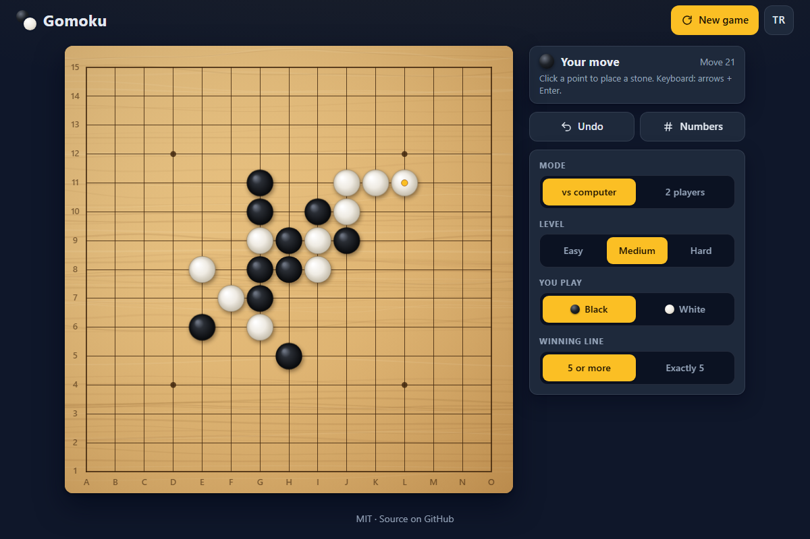

# Gomoku - five in a row on a wooden 15x15 board, against a sharp AI or a friend

[](#tests)
[](LICENSE)

**▶ Play now: https://celaldrg.github.io/gomoku/**



## Features

- Wooden 15x15 board drawn on canvas: star points, coordinates on larger screens, shaded stones, last-move marker, winning-line highlight and optional move numbers. Sharp on high-DPI screens.
- Play the computer (Easy, Medium or Hard; you choose black or white) or a friend on the same device.
- Two rules: **5 or more** (freestyle) or **Exactly 5** (a line of six or more does not win).
- The AI is an alpha-beta search with iterative deepening and threat-aware move ordering. It runs in a Web Worker, so the page never freezes while it thinks.
- Undo (against the computer it takes back your move and its reply) and New game.
- Mouse, touch and keyboard. Phone first: the whole game fits a small screen with no sideways scrolling and large tap targets.
- English and Turkish. Language, settings and the current game are kept in your browser.
- No build step, no dependencies, no external requests. Respects reduced-motion settings.

## How to play

Black moves first. Get five of your stones in an unbroken line: across, down or diagonally.

- **Mouse:** click an intersection.
- **Touch:** tap an intersection to aim (a faint stone appears), then tap the same point again to place it. Slide your finger to move the aim. The page does not scroll while your finger is on the board.
- **Keyboard:** press an arrow key or Tab to the board, move the cursor with the arrow keys, place a stone with Enter or Space. Screen readers hear each cursor position and move.
- **Buttons:** Undo, Numbers (move numbers on the stones), Settings (mode, level, your color, winning rule), New game and the TR / EN language toggle.
- Add `?demo` to the address for a fixed mid-game position (used for the screenshot). A demo game is not saved.

## Run locally

It is a static site. Serve the folder with any static server, for example:

```sh
npx serve .
```

Then open the address it prints. ES modules need `http://`; opening `index.html` straight from disk (`file://`) does not work.

## Tests

```sh
node --test
```

No packages to install (CI runs Node.js 22). The suites are deterministic and finish in a few seconds. They cover:

- board rules: five in every direction, edges and corners, overlines under both rules;
- pattern recognition, scoring and the incremental evaluator;
- AI tactics: takes a win, blocks a four, answers an open three, keeps to its time budget, same move for the same seed;
- 100 seeded games with Medium's settings at a fixed depth of 5 against a random opponent: the AI never loses (it wins all 100);
- game flow: turns, illegal moves, undo, wins, draws, replaying a saved game, the demo position;
- UI helpers: board geometry and hit testing, coordinates, keyboard cursor, status line, settings and saved-game checks, storage that never throws, and English / Turkish strings that match key for key (every key the page uses exists).

## Project structure

```
index.html, style.css     page and styles
src/
  board.js, patterns.js   rules, win detection, line patterns
  engine.js, ai.js        evaluator and alpha-beta search
  ai-worker.js            Web Worker entry for the AI
  game.js, rng.js         game state, undo, demo; seeded random numbers
  main.js                 wires the page together
  ai-client.js            worker messaging with a main-thread fallback
  board-view.js           mouse, touch and keyboard input
  render.js, geometry.js  canvas drawing and board layout
  status.js, settings.js  status line, settings and save validation
  i18n.js, storage.js     English / Turkish strings, safe localStorage
test/                     node:test suites
docs/screenshot.png
```

## License

[MIT](LICENSE) © 2026 Celalettin Durgaç

## Türkçe

Gomoku: ahşap 15x15 tahtada beşi yan yana; güçlü bir yapay zekâya ya da bir arkadaşına karşı.

**▶ Hemen oyna: https://celaldrg.github.io/gomoku/**

### Özellikler

- Canvas'ta çizilen ahşap 15x15 tahta: yıldız noktaları, büyük ekranlarda koordinatlar, gölgeli taşlar, son hamle işareti, kazanan sıranın vurgusu ve isteğe bağlı hamle numaraları. Yüksek çözünürlüklü ekranlarda net.
- Bilgisayara karşı (Kolay, Orta ya da Zor; siyah ya da beyazı sen seçersin) ya da aynı cihazda bir arkadaşa karşı oyna.
- İki kural: **5 ve üzeri** (serbest) ya da **Tam 5** (altı ve daha uzun sıra kazandırmaz).
- Yapay zekâ, yinelemeli derinleştirmeli ve tehdit odaklı hamle sıralamalı bir alfa-beta aramasıdır. Web Worker içinde çalışır; düşünürken sayfa donmaz.
- Geri al (bilgisayara karşı senin hamleni ve cevabını birlikte geri alır) ve Yeni oyun.
- Fare, dokunmatik ve klavye. Önce telefon: oyunun tamamı küçük ekrana sığar, yana kaydırma yok, dokunma alanları büyük.
- İngilizce ve Türkçe. Dil, ayarlar ve süren oyun tarayıcında saklanır.
- Derleme adımı, bağımlılık ve dış istek yok. Azaltılmış hareket ayarına uyar.

### Nasıl oynanır

İlk hamle siyahın. Kendi rengindeki beş taşı kesintisiz bir sıraya diz: yatay, dikey ya da çapraz.

- **Fare:** bir kesişim noktasına tıkla.
- **Dokunmatik:** nişan almak için bir noktaya dokun (soluk bir taş belirir), koymak için aynı noktaya tekrar dokun. Nişanı kaydırmak için parmağını sürükle. Parmağın tahtadayken sayfa kaymaz.
- **Klavye:** bir ok tuşuna bas ya da Tab ile tahtaya gel; imleci ok tuşlarıyla taşı, taşı Enter ya da Boşluk ile koy. Ekran okuyucular her imleç konumunu ve hamleyi duyurur.
- **Düğmeler:** Geri al, Numaralar (taşların üstünde hamle numaraları), Ayarlar (mod, seviye, rengin, kazanan sıra kuralı), Yeni oyun ve TR / EN dil düğmesi.
- Adresin sonuna `?demo` eklersen sabit bir oyun ortası pozisyonu açılır (ekran görüntüsü bununla alındı). Demo oyunu kaydedilmez.

### Yerelde çalıştırma

Statik bir sitedir. Klasörü herhangi bir statik sunucuyla aç, örneğin:

```sh
npx serve .
```

Sonra yazdığı adresi aç. ES modülleri `http://` ister; `index.html` dosyasını doğrudan diskten (`file://`) açmak çalışmaz.

### Testler

```sh
node --test
```

Kurulacak paket yok (CI Node.js 22 kullanır). Testler deterministiktir ve birkaç saniyede biter. Kapsam:

- tahta kuralları: her yönde beşli, kenar ve köşeler, iki kuralda da uzun sıralar;
- dizi kalıplarının tanınması, puanlama ve artımlı değerlendirici;
- yapay zekâ taktikleri: kazanan hamleyi oynar, dörtlüyü keser, açık üçlüye doğru cevap verir, süre bütçesine uyar, aynı tohumla aynı hamleyi seçer;
- Orta seviyenin ayarlarıyla, sabit 5 derinlikte rastgele oynayan rakibe karşı tohumlu 100 oyun: yapay zekâ hiç kaybetmez (100'ünü de kazanır);
- oyun akışı: sıra, geçersiz hamle, geri alma, kazanma, beraberlik, kayıtlı oyunu yeniden kurma, demo pozisyonu;
- arayüz yardımcıları: tahta geometrisi ve tıklama tespiti, koordinatlar, klavye imleci, durum satırı, ayar ve kayıt doğrulaması, hiç hata fırlatmayan depolama, İngilizce ve Türkçe metinlerin anahtar anahtar eşleşmesi (sayfanın kullandığı her anahtar mevcut).

### Proje yapısı

```
index.html, style.css     sayfa ve stiller
src/
  board.js, patterns.js   kurallar, kazanma tespiti, dizi kalıpları
  engine.js, ai.js        değerlendirici ve alfa-beta araması
  ai-worker.js            yapay zekânın Web Worker girişi
  game.js, rng.js         oyun durumu, geri alma, demo; tohumlu rastgele sayılar
  main.js                 sayfanın parçalarını birbirine bağlar
  ai-client.js            Worker mesajlaşması, ana iş parçacığında yedek çalışma
  board-view.js           fare, dokunmatik ve klavye girişi
  render.js, geometry.js  canvas çizimi ve tahta yerleşimi
  status.js, settings.js  durum satırı, ayarlar ve kayıt doğrulaması
  i18n.js, storage.js     İngilizce / Türkçe metinler, güvenli localStorage
test/                     node:test testleri
docs/screenshot.png
```

### Lisans

[MIT](LICENSE) © 2026 Celalettin Durgaç
